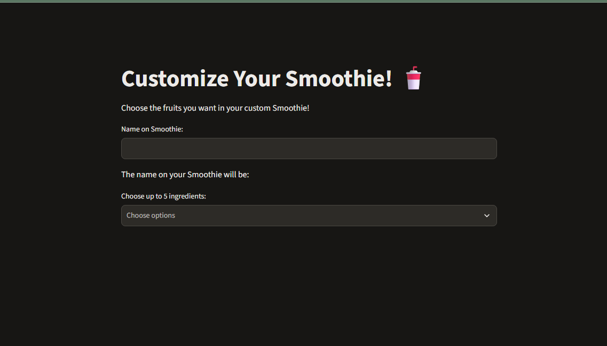

# :cup_with_straw: Custom Smoothie Orders App :cup_with_straw:

## Purpose

This app was created as part of the Snowflake Hands-On Essentials 3: Data Applications Builder Workshop.

The purpose of the app was to act as an order form in a mock diner scenario which customers could use to order a custom smoothie.

Customers would input their name for the order, then select up to 5 fruit options from the list for their smoothie and click the submit.

The app is scripted to input the customers entered data into another 'Pending Orders app' for the diner's kitchen to fulfill the order (see Pending Orders folder for SQL files for this app).

The app was deployed on Streamlit from Github with the file contents below which can be found in the <a href="https://github.com/hjones87/melanies_smoothies">melanies-smoothie Respository </a>

The deployed app can be viewed and interacted with on Streamlit using this link:  <a href="https://melaniessmoothies-s3xgls5snxog4mvx4vnbmr.streamlit.app/">Custom Smoothie Orders App </a>

 

  

## Folder Contents

This folder contains the following files:

- streamlit_app.py file containing the python script for the app layout and contents development
- requirements.txt - defines the Python environment requried when the app is deployed. Includes the version, packages to install (and versions if needed), and additional channels 

