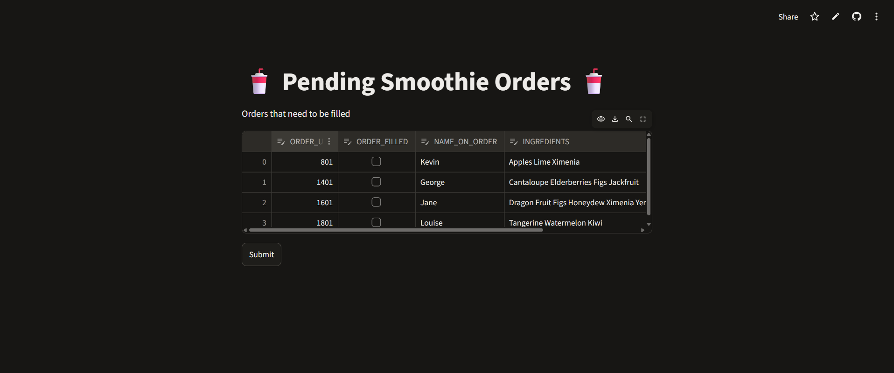

# 🍊 Pending Orders App 🍊

## Purpose

This app was created as part of the Snowflake Hands-On Essentials 3: Data Applications Builder Workshop.

The purpose of the app was to act as as a database of smoothie orders received from customers who had filled-out the Custom Smoothie Order App.

This app stored the name of the customer and the list of fruits they selected for their smoothie. The app has a column which allows employees to click a check box once the order has been filled.

The app was deployed on Streamlit from Github with the file contents below which can be found in the <a href="https://github.com/hjones87/pending_orders">pending_orders Respository </a>

The deployed app can be viewed and interacted with on Streamlit using this link:  <a href="https://pendingorders-kcbpaemqpyeh7ewygkselm.streamlit.app/">Pending Orders App </a>

 

  

## Folder Contents

This folder contains the following files:

- streamlit_app.py file containing the python script for the app layout and contents development
- requirements.txt - defines the Python environment requried when the app is deployed. Includes the version, packages to install (and versions if needed), and additional channels 

