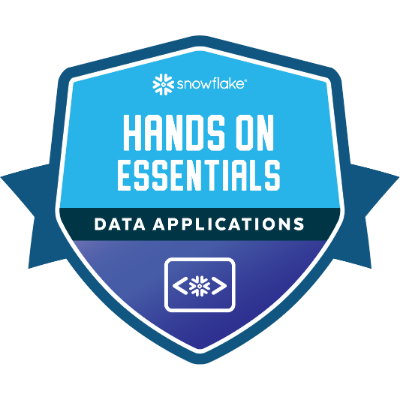

# Snowflake Hands On Essentials: Data Application Builder (Badge 3)

## Achievement

  

  🏅 <strong>Completed 19 November 2026</strong>

  <a href="https://achieve.snowflake.com/5b9253dd-ec11-4696-8b27-9ad5662eda74#acc.6tJnebK9">View Credential</a>

## Repository Contents

This repository contains my SQL scripts and python scripts to build a Custom Smoothie Order app and a Pending Orders app on Streamlit which I completed as part of a Data Application Builder Workshop.

The deployed app for the Custom Smoothie Order can be found using this link:  <a href="https://melaniessmoothies-s3xgls5snxog4mvx4vnbmr.streamlit.app/">Custom Smoothie Orders App </a>

Key topics covered:
- Building and deploying interactive Streamlit applications within Snowflake.
- Developing data-driven applications using Snowpark for Python.
- Consumed REST APIs to retrieve data from external web services and incorporate it into Snowflake applications
- Create and utilise UDFs and stored procedures to support application functionality.
- Apply Snowflake security, governance and deployment best practices for data applications.

For me, this was the most enjoyable workshop. I learned basic python script and applied it to building applications within Streamlit. It was interesting to learn about user-defined functions and hos they can be used to support app functionality aswell as exploring the use of APIs within apps to attain additional information from external websites. Its led to multiple ideas for application designs which I could use in both my personal life and career.
